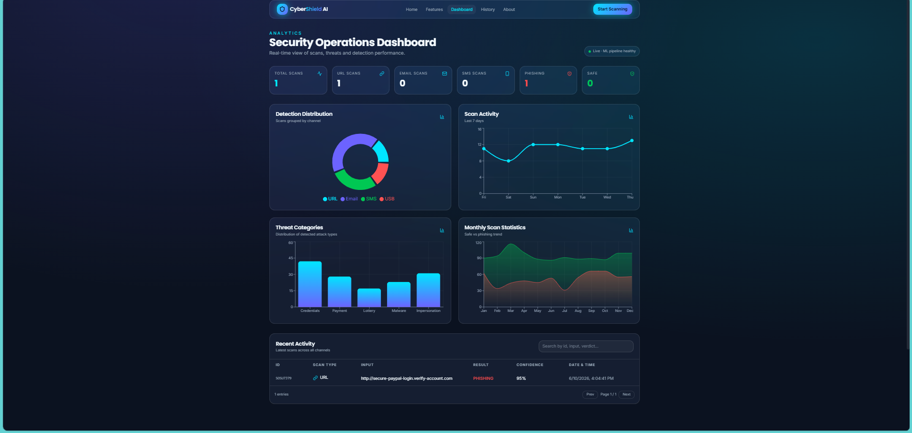
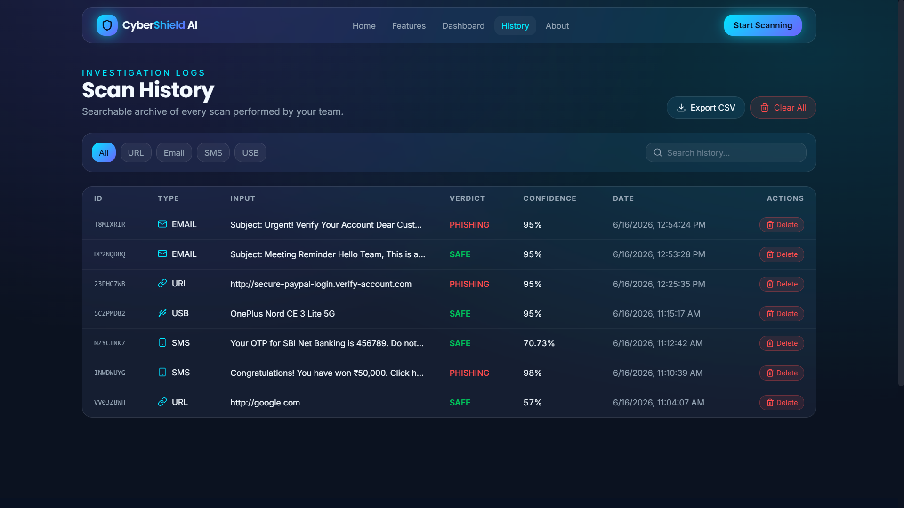

 <div align="center">

# 🛡️ CyberShield AI

### Intelligent Multi-Channel Phishing Detection System

**Detect. Analyze. Protect.**

An AI-powered cybersecurity platform designed to identify phishing threats across URLs, emails, SMS messages, and USB devices.

<br>


<br>

**[View Repository](https://github.com/dharu005/cybershield-ai)**

</div>

---

## 🌐 Overview

CyberShield AI is a multi-channel phishing detection system that uses machine learning to analyze suspicious digital content and help users identify potential cyber threats.

The platform provides separate scanning modules for URLs, emails, SMS messages, and USB devices, along with a dashboard and scan history to make threat monitoring easier.

## ✨ Key Features

| Feature | Description |
|---|---|
| 🔗 URL Detection | Analyzes URLs to identify potentially malicious links |
| 📧 Email Detection | Classifies email messages as safe or phishing |
| 💬 SMS Detection | Detects suspicious and fraudulent SMS messages |
| 💽 USB Threat Scanning | Provides a module for checking USB-related threats |
| 📊 Dashboard | Displays scan information and statistics |
| 🕘 Scan History | Keeps track of previous scanning activity |
| 🌍 Browser Extension | Supports URL checking through a browser extension |
| 🧠 ML-Based Analysis | Uses trained machine learning models and vectorizers |

---

## 🖥️ Application Preview

### 🏠 Home Page


### 📊 Dashboard


### 🔍 Detection Modules

<table>
<tr>
<td width="50%">
<h4 align="center">URL Scanner</h4>

</td>
<td width="50%">
<h4 align="center">Email Scanner</h4>

</td>
</tr>
<tr>
<td width="50%">
<h4 align="center">SMS Scanner</h4>

</td>
<td width="50%">
<h4 align="center">USB Scanner</h4>

</td>
</tr>
</table>

### 📩 Email & SMS Analysis

<table>
<tr>
<td width="50%">

<p align="center">Email Analysis</p>
</td>
<td width="50%">

<p align="center">SMS Analysis</p>
</td>
</tr>
</table>

### 🌐 Browser URL Monitoring


### 📋 Scan History


### ⚙️ Features Overview


---

## 🧠 Machine Learning

CyberShield AI uses trained machine learning models to classify potentially harmful content.

| Detection Module | Model Files |
|---|---|
| URL | `url_model.pkl`, `url_vectorizer.pkl` |
| Email | `email_model.pkl`, `email_vectorizer.pkl` |
| SMS | `sms_model.pkl`, `sms_vectorizer.pkl` |

### Datasets

The project uses datasets for training and evaluating its detection models:

- `dataset_phishing.csv` – URL phishing dataset
- `Phishing_Email.csv` – Email phishing dataset
- `sms_ds.csv` – SMS dataset

---

## 🛠️ Technology Stack

| Category | Technologies |
|---|---|
| Programming Language | Python, JavaScript, TypeScript |
| Frontend | React |
| Backend | Flask |
| Machine Learning | Scikit-learn |
| Data Processing | Pandas |
| Database | SQLite |
| Browser Extension | HTML, CSS, JavaScript |
| Version Control | Git, GitHub |

---

## 📁 Project Structure

```text
CyberShield-AI/
│
├── backend/
│   ├── app.py
│   ├── dataset/
│   ├── models/
│   └── training/
│
├── frontend/
│   ├── src/
│   ├── public/
│   └── package.json
│
├── extension/
│   ├── manifest.json
│   ├── background.js
│   ├── popup.html
│   └── popup.js
│
├── screenshots/
│
├── README.md
└── .gitignore
```

---

## 🚀 Getting Started

### 1. Clone the Repository

```bash
git clone https://github.com/dharu005/cybershield-ai.git
```

### 2. Navigate to the Project

```bash
cd cybershield-ai
```

### 3. Run the Backend

Open a terminal in the backend directory and install the required dependencies:

```bash
pip install -r requirements.txt
```

Start the Flask application using the entry-point configured in your project.

### 4. Run the Frontend

Open another terminal:

```bash
cd frontend
npm install
```

Start the frontend using the development script configured in `package.json`.

---

## 🎯 Project Objectives

- Identify phishing threats across multiple communication channels.
- Apply machine learning techniques to cybersecurity.
- Improve awareness of suspicious links and messages.
- Provide an accessible interface for threat analysis.
- Explore browser-based URL monitoring.

## 🔮 Future Enhancements

- Improve model accuracy through additional training data.
- Add real-time threat intelligence integration.
- Enhance browser extension capabilities.
- Expand threat analysis and reporting.
- Improve explainability of machine learning predictions.

---

## 👩‍💻 Developed By

**Dharani Sundar**

B.E. Computer Science and Engineering  
Artificial Intelligence and Machine Learning

[](https://github.com/dharu005)

---

<div align="center">

### 🛡️ CyberShield AI

**Securing the Digital World, One Scan at a Time.**

⭐ If you find this project interesting, consider giving it a star!

</div>
